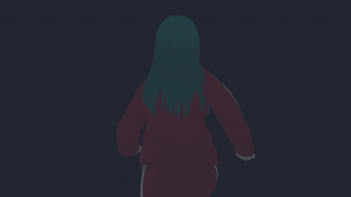
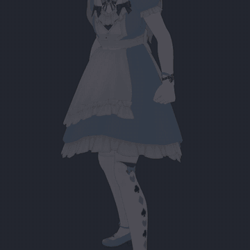
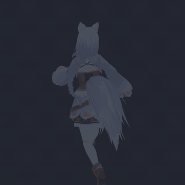
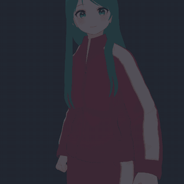

# Bone Cloth

Bone-based cloth for Godot 4.7: hair, skirts, capes, tails and breasts that sway with the character.



[Tutorial](https://youtu.be/B8XE65gJaQk) | [On/Off comparison](https://youtu.be/QDqhtDSR8PA)

  

- `BoneClothSimulator3D` is a `SkeletonModifier3D` that sways bone chains.
- Sphere, capsule, tapered capsule and plane collisions keep the chains out of the body. One shape can cover both sides.
- Neighboring chains can be linked for skirts and capes, and long hair can part over the shoulders.
- Eight presets, editor gizmos, and every class documented in the editor (F1).

## Install

Get it from the [Godot Asset Store](https://store.godotengine.org/asset/pulppixel/bone-cloth/), or download the zip from
[Releases](https://github.com/pulppixel/godot-bone-cloth/releases) and extract it into your project, so that it holds
`addons/bone_cloth/`. It runs on Windows, Linux and macOS.

To build it yourself:

```
git clone --recursive https://github.com/pulppixel/godot-bone-cloth.git
cd godot-bone-cloth
scons target=template_debug
scons target=template_release
```

Then copy `project/addons/bone_cloth` into your project's `addons/`.

## Use

1. Add a `BoneClothSimulator3D` under a `Skeleton3D`.
2. Add a chain and set its root and end bones.
3. Pick a preset from the node's toolbar menu.
4. Add collisions under the simulator and set their bones.

The [tutorial](https://youtu.be/B8XE65gJaQk) walks through these steps. To try the demo, open `project/` in Godot 4.7 and run it.

## License

MIT. Third-party licenses are in `THIRD_PARTY_NOTICES.md`.
